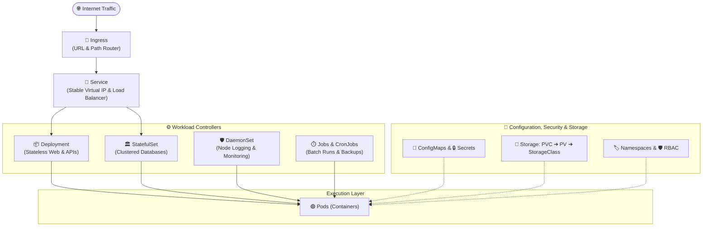

# 🚢 Complete Visual Guide to Kubernetes (K8s) Architecture & Resources

A visual, beginner-friendly encyclopedia of Kubernetes architecture, workload controllers, networking, persistent storage, and cluster administration with native **Mermaid diagrams**, real-world analogies, and copy-pasteable manifests.

---

## 🗺️ Interactive Resource Map

Click on any resource in the table below to open its dedicated deep-dive guide:



---

## 📚 Dedicated Resource Guides

| Chapter | Resource | What It Does | Real-World Analogy |
| :---: | :--- | :--- | :--- |
| **01** | [**🟢 Pod Deep Dive**](docs/01-pod.md) | Smallest deployable unit; holds 1+ containers sharing network & storage. | Space capsule holding astronauts. |
| **02** | [**📦 Deployments & ReplicaSets**](docs/02-deployment-replicaset.md) | Self-healing supervisor, rolling updates, and scaling for stateless apps. | Airline fleet manager. |
| **03** | [**📡 Service (Networking)**](docs/03-service.md) | Stable IP & internal load balancer across dynamic, changing Pod IPs. | Permanent company reception desk. |
| **04** | [**🚪 Ingress Controller**](docs/04-ingress.md) | Smart HTTP/HTTPS reverse proxy routing domains & paths with SSL. | Airport flight departure directory. |
| **05** | [**⚙️ ConfigMaps & Secrets**](docs/05-configmap-secret.md) | Injects plain-text environment variables and Base64 encrypted credentials. | Restaurant menu vs manager's safe. |
| **06** | [**💾 Storage: PV, PVC & StorageClass**](docs/06-storage-pv-pvc.md) | Persistent disks surviving pod restarts (AWS EBS, Azure Disk, NFS). | Storage locker rental voucher. |
| **07** | [**🏛️ StatefulSets**](docs/07-statefulset.md) | Manages stateful clustered apps with fixed ordinal names (`db-0`) & dedicated disks. | Named family pets. |
| **08** | [**🛡️ DaemonSets**](docs/08-daemonset.md) | Guarantees exactly 1 copy runs on every node (log shippers, monitoring). | Building security guard stationed at every door. |
| **09** | [**⏱️ Jobs & CronJobs**](docs/09-jobs-cronjobs.md) | Runs tasks to completion or on scheduled recurring timers (backups, ETL). | Plumber / Night cleaning crew. |
| **10** | [**🏷️ Namespaces, RBAC & Quotas**](docs/10-namespace-rbac.md) | Virtual cluster partitioning, keycard permissions, and CPU/RAM guardrails. | Office building rented floors. |

---

## ⚡ The Ultimate `kubectl` Cheat Sheet

### 1. Viewing & Inspecting
```bash
# List all pods with IP addresses and host node names
kubectl get pods -o wide

# View everything running in the current namespace
kubectl get all

# Inspect events and debug why a pod is failing (CrashLoopBackOff, ImagePullBackOff)
kubectl describe pod <pod-name>

# Stream live application logs from a Pod
kubectl logs -f <pod-name>

# View logs from a previous crashed container
kubectl logs <pod-name> --previous
```

### 2. Deploying & Scaling
```bash
# Apply or update any manifest declaratively
kubectl apply -f manifest.yaml

# Scale replicas up or down instantly
kubectl scale deployment <deployment-name> --replicas=5

# Perform a zero-downtime rolling restart (re-reads ConfigMaps/Secrets)
kubectl rollout restart deployment <deployment-name>

# Check rollout status
kubectl rollout status deployment <deployment-name>

# Undo / Rollback an update instantly
kubectl rollout undo deployment <deployment-name>
```

### 3. Debugging & Port Forwarding
```bash
# Open an interactive shell inside a running pod
kubectl exec -it <pod-name> -- /bin/sh

# Forward a Pod port directly to your laptop (http://localhost:8080)
kubectl port-forward pod/<pod-name> 8080:5000

# Forward a Service port directly to your laptop
kubectl port-forward svc/<service-name> 8080:80

# Check cluster-wide recent warning events
kubectl get events --sort-by='.metadata.creationTimestamp'
```

---

## 🧪 Complete Full-Stack Production Architecture Example

Here is a full end-to-end example demonstrating how a **ConfigMap**, **Secret**, **PVC**, **Database**, **API Server**, and **Service** bind together in production:

```yaml
# 1. Database Password Secret
apiVersion: v1
kind: Secret
metadata:
  name: db-secret
type: Opaque
stringData:
  POSTGRES_PASSWORD: "SuperSecurePassword123!"
---
# 2. Database Persistent Volume Claim
apiVersion: v1
kind: PersistentVolumeClaim
metadata:
  name: postgres-pvc
spec:
  accessModes: ["ReadWriteOnce"]
  resources:
    requests:
      storage: 10Gi
---
# 3. PostgreSQL Database Deployment
apiVersion: apps/v1
kind: Deployment
metadata:
  name: postgres-db
spec:
  replicas: 1
  selector:
    matchLabels:
      app: postgres
  template:
    metadata:
      labels:
        app: postgres
    spec:
      containers:
        - name: postgres
          image: postgres:16-alpine
          ports:
            - containerPort: 5432
          env:
            - name: POSTGRES_PASSWORD
              valueFrom:
                secretKeyRef:
                  name: db-secret
                  key: POSTGRES_PASSWORD
          volumeMounts:
            - name: data
              mountPath: /var/lib/postgresql/data
      volumes:
        - name: data
          persistentVolumeClaim:
            claimName: postgres-pvc
---
# 4. Internal Database Service (ClusterIP)
apiVersion: v1
kind: Service
metadata:
  name: postgres-service
spec:
  type: ClusterIP
  selector:
    app: postgres
  ports:
    - port: 5432
      targetPort: 5432
---
# 5. Public-Facing Web API Deployment
apiVersion: apps/v1
kind: Deployment
metadata:
  name: web-api
spec:
  replicas: 3
  selector:
    matchLabels:
      app: web-api
  template:
    metadata:
      labels:
        app: web-api
    spec:
      containers:
        - name: api
          image: nginx:alpine
          ports:
            - containerPort: 80
          resources:
            requests:
              cpu: 100m
              memory: 128Mi
            limits:
              cpu: 500m
              memory: 256Mi
---
# 6. Public Ingress LoadBalancer Service
apiVersion: v1
kind: Service
metadata:
  name: web-api-service
spec:
  type: LoadBalancer
  selector:
    app: web-api
  ports:
    - port: 80
      targetPort: 80
```

---

### 👨‍💻 Maintained by [Guru Hemanth](https://github.com/guruhemanth)
Contributions and stars are welcome! ⭐️
