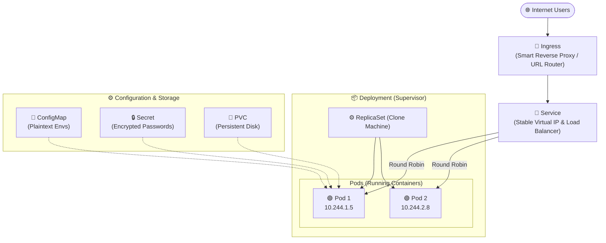
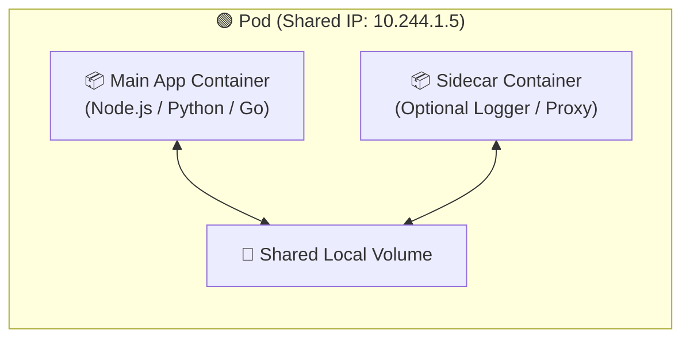
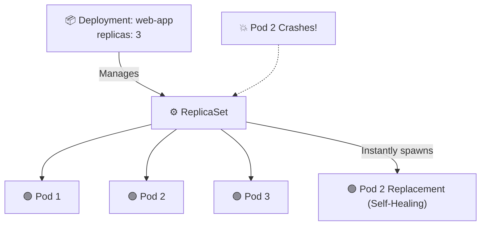
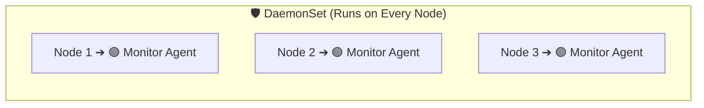
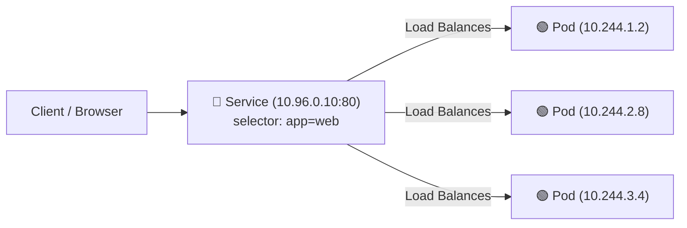
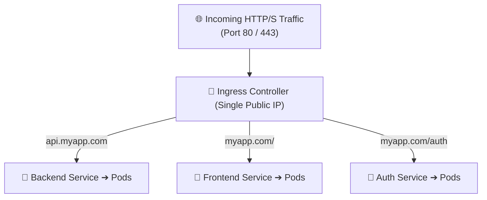
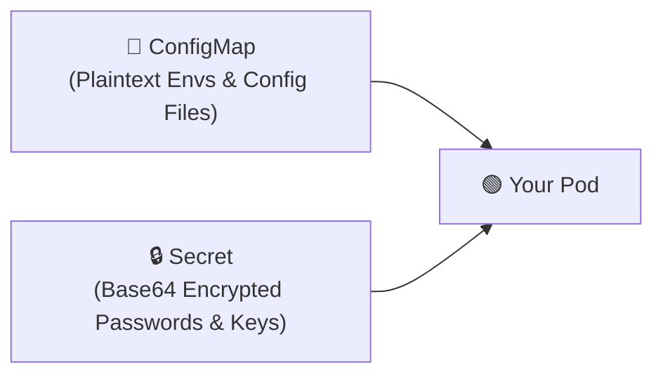
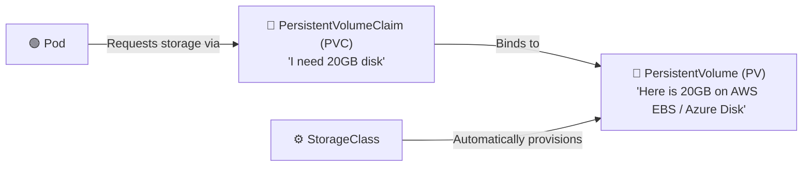

# 🚢 The Beginner's Visual Guide to Kubernetes (K8s)

A visual, beginner-friendly reference for understanding Kubernetes resources, architecture, networking, storage, and daily commands.

---

## 📑 Table of Contents
1. [The Big Picture: How Everything Connects](#-the-big-picture-how-everything-connects)
2. [Compute & Workload Resources](#1-compute--workload-resources)
   - [Pod](#-pod)
   - [Deployment](#-deployment)
   - [StatefulSet vs DaemonSet vs Job](#-statefulset-vs-daemonset-vs-job)
3. [Networking Resources](#2-networking-resources)
   - [Service (ClusterIP, NodePort, LoadBalancer)](#-service)
   - [Ingress](#-ingress)
4. [Configuration & Security](#3-configuration--security)
   - [ConfigMap](#-configmap)
   - [Secret](#-secret)
5. [Storage Resources](#4-storage-resources)
   - [PV, PVC, and StorageClass](#-persistent-storage-pvc--pv)
6. [Cluster Organization](#5-cluster-organization)
   - [Namespaces](#-namespaces)
7. [Essential kubectl Cheat Sheet](#-essential-kubectl-cheat-sheet)

---

## 🗺️ The Big Picture: How Everything Connects

Here is how traffic flows from a user on the internet down to your application container:



---

## 1. Compute & Workload Resources

### 🟢 Pod
> **Analogy:** A pea pod holding one or more peas (containers).

A **Pod** is the smallest deployable unit in Kubernetes. Kubernetes runs your Docker containers inside Pods.



- **Shared Network:** All containers in a Pod share the same IP address and can talk to each other via `localhost`.
- **Ephemeral:** If a Pod crashes or its worker node dies, Kubernetes **will not** resurrect it unless it is managed by a Deployment or Controller.

#### Minimal Pod Example:
```yaml
apiVersion: v1
kind: Pod
metadata:
  name: my-app-pod
  labels:
    app: my-app
spec:
  containers:
    - name: web-server
      image: nginx:alpine
      ports:
        - containerPort: 80
```

---

### 📦 Deployment
> **Analogy:** The automated factory manager.

In production, you almost never create bare Pods. You create a **Deployment** to manage them.



#### Why use Deployments?
1. **Self-Healing:** If a pod or node crashes, replacement pods are spawned immediately.
2. **Scaling:** Change from 2 to 20 replicas with a single command.
3. **Zero-Downtime Rolling Updates:** Updates your application image version-by-version with 0 seconds of user downtime.

#### Minimal Deployment Example:
```yaml
apiVersion: apps/v1
kind: Deployment
metadata:
  name: web-app-deployment
spec:
  replicas: 3
  selector:
    matchLabels:
      app: web-app
  template:
    metadata:
      labels:
        app: web-app
    spec:
      containers:
        - name: web
          image: nginx:1.25
          ports:
            - containerPort: 80
```

---

### 🔄 StatefulSet vs. DaemonSet vs. Job

| Resource | Purpose | Real-World Analogy | Common Example |
| :--- | :--- | :--- | :--- |
| **StatefulSet** | For apps that need **fixed names** and **dedicated persistent disks** in strict order (`db-0`, `db-1`, `db-2`). | Numbered lockers with personal keys. | Databases: PostgreSQL, MongoDB, Kafka, Redis. |
| **DaemonSet** | Guarantees that **exactly 1 copy** runs on **every single Node** in the cluster. | A security guard stationed at every building entrance. | Log collectors (`Fluentd`), node monitors (`Prometheus Node Exporter`). |
| **Job / CronJob** | Runs a task to completion (or on a recurring schedule) and terminates cleanly. | A scheduled night cleaning service. | Database backups, batch jobs, email newsletters. |



---

## 2. Networking Resources

Pods are temporary. They get destroyed, rescheduled, and receive completely new IP addresses constantly. **A Service gives clients a permanent address to reach your Pods.**

### 📡 Service
> **Analogy:** The permanent reception desk of a company.



#### The 3 Common Service Types:
1. **`ClusterIP` (Default):**
   - Accessible **only inside** the cluster.
   - Ideal for databases, backend REST APIs, and internal microservices.
2. **`NodePort`:**
   - Opens a dedicated high port (between 30000–32767) on **every node's external IP address**.
   - Accessible from outside via `http://<Node-IP>:<NodePort>`.
3. **`LoadBalancer`:**
   - Automatically provisions a real Public IP from your cloud provider (AWS ALB/NLB, Azure Load Balancer, GCP Cloud LB).
   - Ideal for public internet-facing applications.

#### Minimal Service Example:
```yaml
apiVersion: v1
kind: Service
metadata:
  name: web-service
spec:
  type: ClusterIP   # Or NodePort / LoadBalancer
  selector:
    app: web-app    # Connects to Pods with this label
  ports:
    - protocol: TCP
      port: 80         # Port the service exposes
      targetPort: 80   # Port your container listens on
```

---

### 🚪 Ingress
> **Analogy:** The airport departures board routing passengers to the correct gate based on flight destination.

Instead of paying for 10 separate cloud `LoadBalancers` for 10 microservices, an **Ingress** acts as a single, smart reverse proxy (e.g. Nginx, Traefik) routing traffic based on hostnames and URL paths.



#### Minimal Ingress Example:
```yaml
apiVersion: networking.k8s.io/v1
kind: Ingress
metadata:
  name: app-ingress
spec:
  rules:
    - host: myapp.com
      http:
        paths:
          - path: /api
            pathType: Prefix
            backend:
              service:
                name: backend-service
                port:
                  number: 5000
          - path: /
            pathType: Prefix
            backend:
              service:
                name: frontend-service
                port:
                  number: 80
```

---

## 3. Configuration & Security

Never hardcode database URLs or API keys inside container images.



### 📄 ConfigMap
- Stores **plain-text** configuration (environment variables, config files).
- Examples: `PORT=5000`, `LOG_LEVEL=info`, `APP_ENV=production`.

```yaml
apiVersion: v1
kind: ConfigMap
metadata:
  name: app-config
data:
  PORT: "5000"
  NODE_ENV: "production"
```

### 🔒 Secret
- Stores **sensitive** data (passwords, tokens, TLS certificates).
- Values are Base64 encoded inside Kubernetes.

```yaml
apiVersion: v1
kind: Secret
metadata:
  name: app-secrets
type: Opaque
stringData:
  DATABASE_PASSWORD: "SuperSecretPassword123!"
  JWT_SECRET: "my_secure_jwt_token"
```

---

## 4. Persistent Storage (PVC & PV)

By default, container storage is **ephemeral**; when a Pod restarts, any files created inside are deleted. To store data permanently (like a database), use Persistent Volumes:



1. **PersistentVolumeClaim (PVC):** The request voucher made by your app (*"Give me a 10GB drive"*).
2. **PersistentVolume (PV):** The actual disk provisioned in your cloud or local storage.
3. **StorageClass:** The automated provisioner that creates a PV on demand whenever a PVC asks for one.

#### Minimal PVC Example:
```yaml
apiVersion: v1
kind: PersistentVolumeClaim
metadata:
  name: postgres-pvc
spec:
  accessModes:
    - ReadWriteOnce
  resources:
    requests:
      storage: 10Gi
```

---

## 5. Cluster Organization

### 🏷️ Namespaces
> **Analogy:** Separate apartments inside the same building.

Namespaces partition a single physical Kubernetes cluster into multiple virtual clusters:
- `default`: The default space for apps when no namespace is specified.
- `kube-system`: Reserved for Kubernetes internal controllers (CoreDNS, API server).
- `development` / `staging` / `production`: How teams isolate environments safely.

```bash
# Create a namespace
kubectl create namespace staging

# Run commands in a specific namespace
kubectl get pods -n staging
```

---

## ⚡ Essential kubectl Cheat Sheet

### 🔍 Viewing & Inspecting Resources
| Command | What it does |
| :--- | :--- |
| `kubectl get pods` | List all running Pods |
| `kubectl get pods -o wide` | List Pods with IP addresses and node placements |
| `kubectl get all` | Display all resources running in current namespace |
| `kubectl describe pod <name>` | Detailed events & troubleshooting info (why a pod failed) |
| `kubectl logs -f <name>` | Stream live application logs from a Pod |

### 🚀 Deploying & Managing
| Command | What it does |
| :--- | :--- |
| `kubectl apply -f manifest.yaml` | Create or update resources declaratively |
| `kubectl delete -f manifest.yaml` | Tear down resources defined in a YAML file |
| `kubectl scale deployment <name> --replicas=5` | Scale a deployment to 5 copies instantly |
| `kubectl rollout restart deployment <name>` | Perform zero-downtime rolling restart |

### 🛠️ Debugging & Troubleshooting
| Command | What it does |
| :--- | :--- |
| `kubectl exec -it <pod-name> -- /bin/sh` | Open an interactive terminal inside a running container |
| `kubectl port-forward pod/<name> 8080:80` | Forward pod port `80` to `localhost:8080` on your laptop |
| `kubectl get events --sort-by='.metadata.creationTimestamp'` | View recent cluster errors and events |

---

### 👨‍💻 Created for DevOps & Kubernetes Mastery
Happy clustering! 🚀
