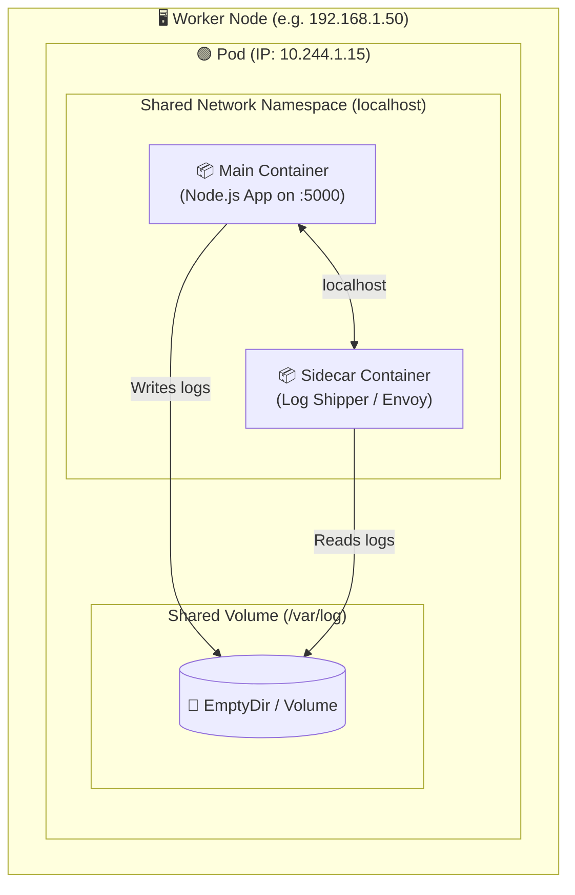
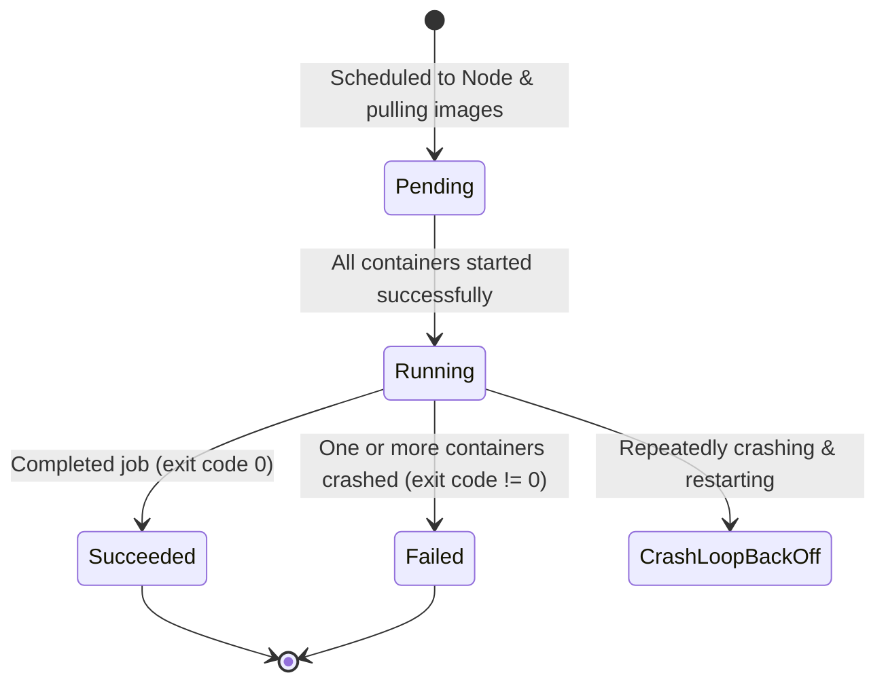

# 🟢 Kubernetes Pod Deep Dive

A **Pod** is the smallest and simplest unit in the Kubernetes object model. It represents a single instance of a running process in your cluster.

---

## 💡 Real-World Analogy
Think of a Pod like a **space capsule**. 
- The capsule provides life support, an air supply, and radio communication (shared IP, shared network, shared storage).
- Inside the capsule, you can have one astronaut (single-container Pod) or multiple specialized astronauts working together (multi-container sidecar pattern).

---

## 📊 Visual Representation



---

## ⚙️ How a Pod Works Under the Hood

1. **Shared Network:** Every container in the Pod shares the same network namespace, including the IP address and network ports. Containers communicate with each other using `localhost`.
2. **Shared Storage:** Containers can mount shared storage volumes to exchange files.
3. **The Pause Container (`k8s.gcr.io/pause`):** When Kubernetes starts a Pod, it first launches an invisible `pause` container. This container sets up the Linux network namespace and holds the IP address so other containers can join it.
4. **Ephemeral Nature:** Pods do not heal themselves. If a Pod is scheduled on a Node that dies, the Pod is deleted. (That's why we use **Deployments**).

---

## 🔄 Pod Lifecycle & States



- **Pending:** The Pod is accepted by the cluster, but images are downloading or waiting for node scheduling.
- **Running:** The Pod is bound to a Node and at least one container is running.
- **Succeeded:** All containers terminated with exit code 0 (common in Jobs).
- **Failed:** A container terminated with a non-zero exit code.
- **CrashLoopBackOff:** A container keeps crashing immediately after startup; K8s waits with exponential backoff before trying again.

---

## 📝 YAML Manifests

### Beginner Pod (Single Container)
```yaml
apiVersion: v1
kind: Pod
metadata:
  name: basic-web-pod
  labels:
    app: web
spec:
  containers:
    - name: nginx
      image: nginx:alpine
      ports:
        - containerPort: 80
```

### Production Pod (Probes, Resource Limits, Sidecar)
```yaml
apiVersion: v1
kind: Pod
metadata:
  name: production-pod
  labels:
    app: api
    tier: backend
spec:
  restartPolicy: Always
  containers:
    # 1. Main Application Container
    - name: api-server
      image: node:20-alpine
      command: ["node", "server.js"]
      ports:
        - containerPort: 5000
      resources:
        requests:
          memory: "128Mi"
          cpu: "100m"
        limits:
          memory: "512Mi"
          cpu: "500m"
      livenessProbe:
        httpGet:
          path: /healthz
          port: 5000
        initialDelaySeconds: 15
        periodSeconds: 10
      readinessProbe:
        httpGet:
          path: /ready
          port: 5000
        initialDelaySeconds: 5
        periodSeconds: 5
      volumeMounts:
        - name: shared-logs
          mountPath: /app/logs

    # 2. Sidecar Container (Log Collector)
    - name: log-collector
      image: busybox
      command: ["sh", "-c", "tail -n+1 -F /logs/app.log"]
      volumeMounts:
        - name: shared-logs
          mountPath: /logs

  volumes:
    - name: shared-logs
      emptyDir: {}
```

---

## 🔍 Essential Troubleshooting Commands

```bash
# List all pods with IP addresses and host node names
kubectl get pods -o wide

# Inspect why a pod is stuck in Pending or CrashLoopBackOff
kubectl describe pod <pod-name>

# View live streaming logs
kubectl logs -f <pod-name>

# View logs for a specific container in a multi-container pod
kubectl logs <pod-name> -c api-server

# View logs from a previous crashed container instance
kubectl logs <pod-name> --previous

# Exec into a running pod container
kubectl exec -it <pod-name> -- /bin/sh

# Forward port to test on localhost
kubectl port-forward pod/<pod-name> 8080:5000
```

---

## ⚠️ Common Pitfalls & Solutions

| Error | Root Cause | How to Fix |
| :--- | :--- | :--- |
| `ImagePullBackOff` | Wrong image name, tag typo, or missing private Docker registry credentials. | Check image name with `kubectl describe pod` and add `imagePullSecrets`. |
| `CrashLoopBackOff` | Application code crashed, missing environment variable, or missing database connection. | Run `kubectl logs <pod-name> --previous` to see the stack trace. |
| `OOMKilled` (Exit 137) | Container exceeded its memory limit (`limits.memory`). | Increase the memory limit in the `resources` section. |
| `Pending` | Cluster has insufficient CPU/memory, or no nodes match nodeSelector/taints. | Run `kubectl describe pod <pod-name>` and inspect the **Events** section at the bottom. |
