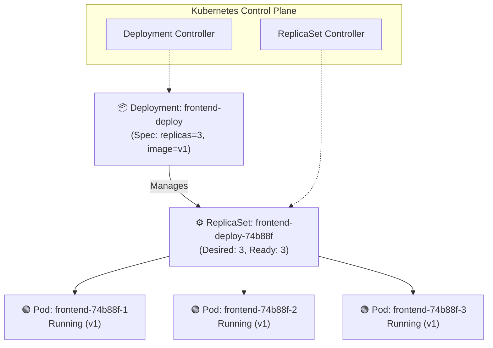
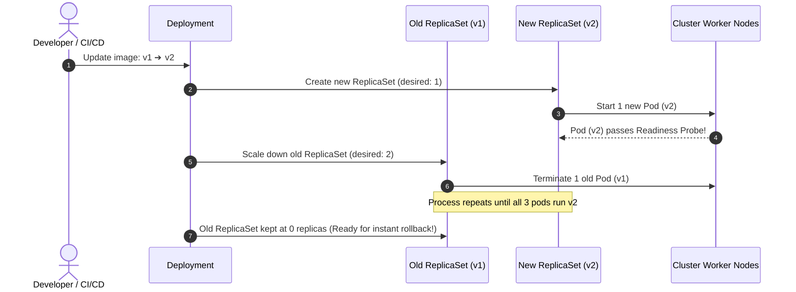

# 📦 Kubernetes Deployment & ReplicaSet Deep Dive

A **Deployment** is a higher-level supervisor that manages **ReplicaSets**, which in turn manage **Pods**. It provides declarative updates for Pods and ReplicaSets, self-healing, scaling, and zero-downtime rolling releases.

---

## 💡 Real-World Analogy
Think of a Deployment like the **Operations Manager of an airline**:
- The Manager (Deployment) says: *"We always need 3 planes in the sky running flight software v2."*
- The Flight Coordinator (ReplicaSet) constantly checks the radar. If a plane goes down, it launches an exact clone immediately.
- When an upgrade to software v3 is released, the Manager upgrades planes one-by-one so passengers never experience a service outage.

---

## 📊 Visual Representation: Architecture & Hierarchy



---

## 🔄 How Zero-Downtime Rolling Updates Work

When you update the container image from `v1` to `v2`, Kubernetes does **NOT** kill all old pods at once. Instead, it creates a **new ReplicaSet** and shifts traffic gradually:



---

## ⚙️ Core Configuration: `maxSurge` & `maxUnavailable`

In the Deployment spec, you can fine-tune how aggressive the rolling update is:

```yaml
strategy:
  type: RollingUpdate
  rollingUpdate:
    maxSurge: 25%         # Maximum number of pods that can be created above desired count
    maxUnavailable: 25%   # Maximum number of pods that can be unavailable during update
```

- **`maxSurge`:** How many extra Pods can temporarily run during the rollout.
- **`maxUnavailable`:** How many Pods can be offline while replacing.

---

## 📝 YAML Manifests

### Beginner Deployment
```yaml
apiVersion: apps/v1
kind: Deployment
metadata:
  name: basic-nginx-deploy
  labels:
    app: nginx
spec:
  replicas: 3
  selector:
    matchLabels:
      app: nginx
  template:
    metadata:
      labels:
        app: nginx
    spec:
      containers:
        - name: nginx
          image: nginx:1.25-alpine
          ports:
            - containerPort: 80
```

### Production Deployment (Rolling Strategy, Health Probes & Resource Limits)
```yaml
apiVersion: apps/v1
kind: Deployment
metadata:
  name: api-deployment
  labels:
    app: api-service
    tier: backend
spec:
  replicas: 4
  revisionHistoryLimit: 5  # Keeps 5 old ReplicaSets for rollbacks
  strategy:
    type: RollingUpdate
    rollingUpdate:
      maxSurge: 1
      maxUnavailable: 0    # Ensures 100% capacity maintained during updates
  selector:
    matchLabels:
      app: api-service
  template:
    metadata:
      labels:
        app: api-service
    spec:
      containers:
        - name: api
          image: myregistry.azurecr.io/api:v1.2.0
          imagePullPolicy: IfNotPresent
          ports:
            - name: http
              containerPort: 8080
          resources:
            requests:
              cpu: 100m
              memory: 128Mi
            limits:
              cpu: 500m
              memory: 512Mi
          readinessProbe:
            httpGet:
              path: /health/ready
              port: 8080
            initialDelaySeconds: 5
            periodSeconds: 5
          livenessProbe:
            httpGet:
              path: /health/live
              port: 8080
            initialDelaySeconds: 15
            periodSeconds: 10
```

---

## 🔍 Essential Deployment Commands

```bash
# 1. View deployments and current status
kubectl get deployments
kubectl get replicasets

# 2. Scale deployment up or down
kubectl scale deployment api-deployment --replicas=6

# 3. Update container image (Triggers rolling update)
kubectl set image deployment/api-deployment api=myregistry.azurecr.io/api:v1.3.0

# 4. Watch the live rollout progress
kubectl rollout status deployment/api-deployment

# 5. View revision history
kubectl rollout history deployment/api-deployment

# 6. INSTANT ROLLBACK to the previous version
kubectl rollout undo deployment/api-deployment

# 7. Rollback to a specific revision (e.g. revision 2)
kubectl rollout undo deployment/api-deployment --to-revision=2

# 8. Restart all pods in a deployment without downtime (re-reads secrets/configs)
kubectl rollout restart deployment/api-deployment
```

---

## ⚠️ Troubleshooting Deployments

| Problem | Symptoms | Solution |
| :--- | :--- | :--- |
| **Rollout Stuck** | `kubectl rollout status` hangs. | Check `kubectl describe deployment <name>`. Most often, new pods are failing readiness probes or hitting `ImagePullBackOff`. |
| **Pods Not Assigned to ReplicaSet** | Deployment shows 0/3 ready. | Verify `spec.selector.matchLabels` matches `spec.template.metadata.labels` **exactly**. If labels don't match, the deployment cannot adopt the pods. |
| **Crash Loop on Update** | New pods crash immediately. | Run `kubectl rollout undo deployment/<name>` immediately to revert to the safe previous version, then debug application logs. |
