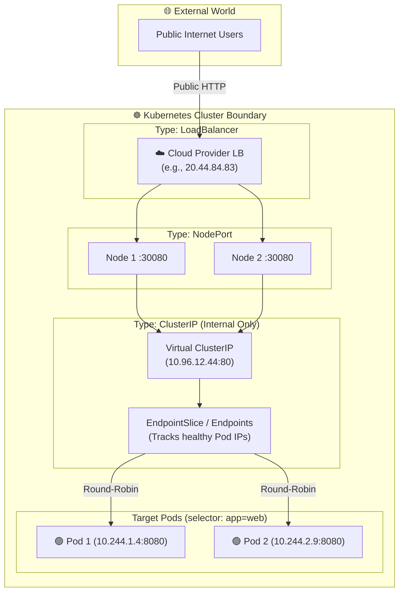
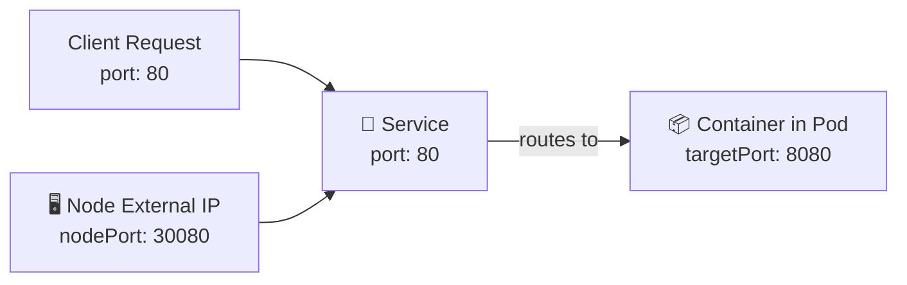

# 📡 Kubernetes Service Deep Dive

A **Service** is an abstract way to expose an application running on a set of Pods as a network service. It provides a **stable virtual IP address**, **DNS name**, and **load balancing** across dynamic, ephemeral Pods.

---

## 💡 Real-World Analogy
Think of a Service like a **hotel front desk phone number**:
- Individual customer support staff (Pods) change shifts, go on break, or get replaced every few hours (new Pod IPs).
- Guests don't need to know the personal phone number of individual workers.
- They simply dial the **front desk extension** (Service IP). The switchboard automatically routes the call to any currently available worker.

---

## 📊 Visual Representation: The 3 Main Service Types



---

## 🔍 Understanding Ports: `port` vs `targetPort` vs `nodePort`

A common source of confusion for beginners:



- **`port`:** The port that the **Service itself exposes** inside the cluster (e.g. port `80`).
- **`targetPort`:** The port that your **container application is actually listening on** inside the Pod (e.g. Node.js on `8080` or `5000`).
- **`nodePort`:** A dedicated port opened on **every physical Node's IP** (range 30000–32767). Used only when `type: NodePort` or `LoadBalancer`.

---

## ⚙️ Service Types Breakdown

| Service Type | Scope | How It Works | Ideal Use Case |
| :--- | :--- | :--- | :--- |
| **`ClusterIP`** | **Internal Only** | Default. Allocates an internal virtual IP reachable only inside the cluster. | Backend APIs, databases, internal microservices. |
| **`NodePort`** | **External (Port based)** | Opens a high port (`30000-32767`) on every cluster node. | On-prem clusters without cloud load balancers, local testing. |
| **`LoadBalancer`** | **External (Cloud IP)** | Asks AWS / Azure / GCP to spin up a native cloud load balancer with a real Public IP. | Production public-facing websites and APIs. |
| **`Headless`** (`clusterIP: None`) | **Direct Pod IPs** | Does not allocate a virtual IP; returns direct Pod IPs via CoreDNS. | StatefulSets, database master-replica clustering. |

---

## 📝 YAML Manifests

### 1. ClusterIP Service (Internal Microservice)
```yaml
apiVersion: v1
kind: Service
metadata:
  name: backend-service
  labels:
    app: backend
spec:
  type: ClusterIP
  selector:
    app: backend          # Matches Pods with 'app: backend'
  ports:
    - name: http
      protocol: TCP
      port: 80            # Service IP port
      targetPort: 5000    # Container port
```

### 2. LoadBalancer Service (Public Internet)
```yaml
apiVersion: v1
kind: Service
metadata:
  name: frontend-loadbalancer
  labels:
    app: frontend
spec:
  type: LoadBalancer
  selector:
    app: frontend
  ports:
    - name: http
      protocol: TCP
      port: 80
      targetPort: 80
```

### 3. Headless Service (For Databases & StatefulSets)
```yaml
apiVersion: v1
kind: Service
metadata:
  name: postgres-headless
spec:
  clusterIP: None         # Disables Virtual IP (Headless)
  selector:
    app: postgres
  ports:
    - port: 5432
      name: postgres
```

---

## 🌐 Internal DNS Resolution (CoreDNS)

Kubernetes includes an internal DNS server (**CoreDNS**). Any Pod can talk to any Service using standard hostnames:

```text
http://<service-name>.<namespace>.svc.cluster.local:<port>
```

- **Same Namespace:** `http://backend-service:80`
- **Different Namespace:** `http://backend-service.staging.svc.cluster.local:80`

---

## 🔍 Essential Service Commands & Debugging

```bash
# 1. List all services and their allocated IPs/Ports
kubectl get svc
kubectl get svc -o wide

# 2. Inspect which Pod IPs are currently registered to the service
kubectl get endpoints <service-name>
kubectl get endpointslices

# 3. Detailed inspection of selector and routing
kubectl describe svc <service-name>

# 4. Test service connectivity from inside the cluster using a temporary curl pod
kubectl run test-curl --rm -it --image=curlimages/curl -- curl http://backend-service:80/api/health

# 5. Temporarily map service port to your laptop
kubectl port-forward svc/backend-service 8080:80
```

---

## ⚠️ Troubleshooting Services

| Symptom | Root Cause | Fix |
| :--- | :--- | :--- |
| **`Endpoints: <none>`** | The Service selector does **not match** any running Pod labels, or the Pods are failing readiness probes. | Run `kubectl get pods --show-labels` and ensure `spec.selector` in the Service matches the Pod labels exactly. |
| **Connection Refused** | The `targetPort` in the Service does not match the actual port the container is listening on. | Verify your app's listening port in the Dockerfile / server code, and update `targetPort`. |
| **External IP Pending** | On local clusters (Minikube / Kind) or on-prem without a cloud controller, `LoadBalancer` cannot provision a cloud IP. | Use `type: NodePort` or run `minikube tunnel` / MetalLB. |
