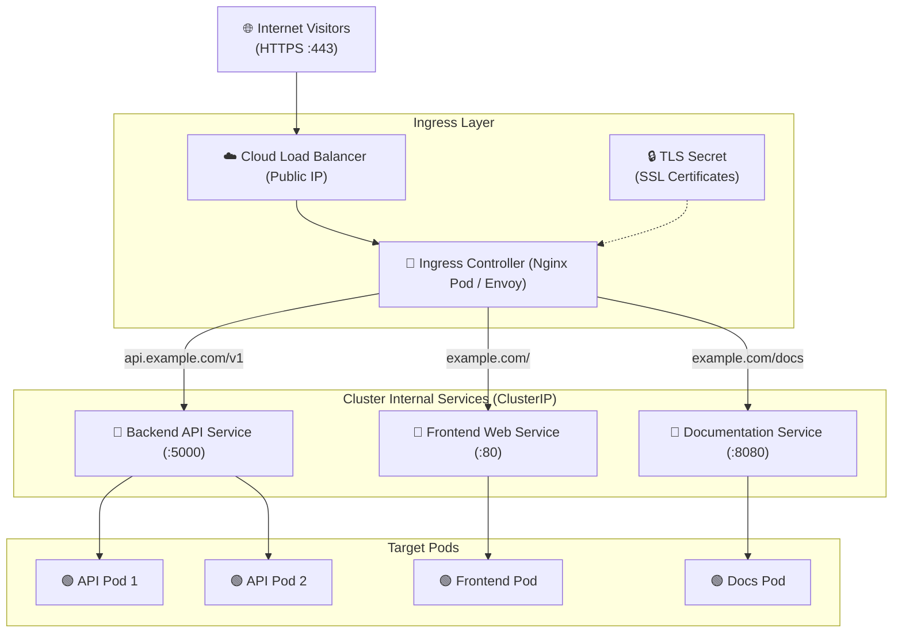

# 🚪 Kubernetes Ingress Deep Dive

An **Ingress** is an API object that manages external access to the services in a cluster, typically HTTP and HTTPS. It provides **URL-based routing**, **virtual hosting (domain-based)**, and **SSL/TLS termination** through a single entry point.

---

## 💡 Real-World Analogy
Think of an Ingress like the **main entrance receptionist & directory** of an office skyscraper:
- Instead of building a private highway from the street directly to each individual office room (expensive `LoadBalancer` for every service), there is one **grand revolving door** (the Ingress).
- A visitor walks in and asks:
  - *"I want the accounting department"* (`/finance`) ➔ Guided to Service A.
  - *"I want customer service"* (`/support`) ➔ Guided to Service B.
  - *"I am visiting from domain.com"* ➔ Guided to the proper company floor.

---

## 📊 Visual Representation: Ingress Architecture & Routing



---

## ⚙️ Ingress Resource vs. Ingress Controller

A critical distinction for Kubernetes engineers:

| Component | What It Is | Analogy | Examples |
| :--- | :--- | :--- | :--- |
| **Ingress Resource** | A **YAML document** describing routing rules, hosts, and paths. | The rulebook / road sign. | `kind: Ingress` manifest. |
| **Ingress Controller** | An actual **running application** (usually an Nginx reverse proxy) that reads the Ingress YAML and executes the routing. | The traffic cop following the rulebook. | `ingress-nginx`, Traefik, HAProxy, AWS Load Balancer Controller. |

> [!IMPORTANT]
> Creating an `Ingress` YAML without an installed **Ingress Controller** will do nothing! The controller must be running in your cluster to fulfill the rules.

---

## 📝 YAML Manifests

### 1. Path-Based Routing (Single Domain, Multiple Endpoints)
```yaml
apiVersion: networking.k8s.io/v1
kind: Ingress
metadata:
  name: path-based-ingress
  annotations:
    nginx.ingress.kubernetes.io/rewrite-target: /
spec:
  ingressClassName: nginx
  rules:
    - host: myapp.com
      http:
        paths:
          # Traffic to myapp.com/api routes to backend
          - path: /api
            pathType: Prefix
            backend:
              service:
                name: backend-service
                port:
                  number: 5000
          # Traffic to myapp.com/ routes to frontend
          - path: /
            pathType: Prefix
            backend:
              service:
                name: frontend-service
                port:
                  number: 80
```

### 2. Domain / Host-Based Routing (Multiple Subdomains)
```yaml
apiVersion: networking.k8s.io/v1
kind: Ingress
metadata:
  name: host-based-ingress
spec:
  ingressClassName: nginx
  rules:
    - host: api.company.com
      http:
        paths:
          - path: /
            pathType: Prefix
            backend:
              service:
                name: api-service
                port:
                  number: 5000

    - host: dashboard.company.com
      http:
        paths:
          - path: /
            pathType: Prefix
            backend:
              service:
                name: dashboard-service
                port:
                  number: 3000
```

### 3. Production Ingress with SSL/TLS Termination
```yaml
apiVersion: networking.k8s.io/v1
kind: Ingress
metadata:
  name: production-secure-ingress
  annotations:
    cert-manager.io/cluster-issuer: "letsencrypt-prod"
    nginx.ingress.kubernetes.io/ssl-redirect: "true"
spec:
  ingressClassName: nginx
  tls:
    - hosts:
        - myapp.com
      secretName: myapp-tls-cert   # Kubernetes Secret holding fullchain.pem and privkey.pem
  rules:
    - host: myapp.com
      http:
        paths:
          - path: /
            pathType: Prefix
            backend:
              service:
                name: frontend-service
                port:
                  number: 80
```

---

## 🔍 Essential Ingress Commands

```bash
# 1. View all Ingresses and assigned Address (Public IP)
kubectl get ingress
kubectl get ingress -o wide

# 2. Inspect backend service bindings and annotations
kubectl describe ingress <ingress-name>

# 3. View Ingress Controller live logs (Useful for 404 / 502 debug)
kubectl logs -n ingress-nginx -l app.kubernetes.io/name=ingress-nginx -f

# 4. Test Ingress locally by overriding the Host header
curl -H "Host: myapp.com" http://<INGRESS_CONTROLLER_IP>/api/health
```

---

## ⚠️ Troubleshooting Ingress

| Problem | Root Cause | Solution |
| :--- | :--- | :--- |
| **`ADDRESS` is Blank** | Ingress controller is not running, or failed to bind to a cloud LoadBalancer. | Check `kubectl get pods -n ingress-nginx` to verify the controller is healthy. |
| **`404 Not Found`** | URL path mismatch or missing `rewrite-target` annotation. | If your app expects `/health` but ingress receives `/api/health`, add `nginx.ingress.kubernetes.io/rewrite-target`. |
| **`502 Bad Gateway`** | The target backend Service or Pod is down or not responding on `targetPort`. | Run `kubectl get endpoints <service-name>` to confirm healthy pods are attached. |
| **SSL Certificate Invalid** | Missing TLS secret, expired cert, or cert-manager failed challenge. | Check `kubectl get secret <secretName>` and `kubectl describe certificate`. |
