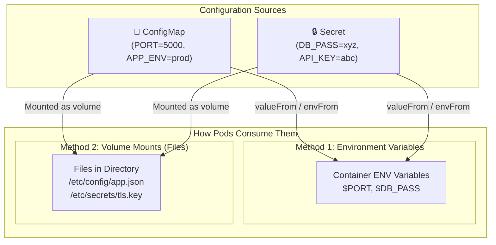

# ⚙️ Kubernetes ConfigMap & Secret Deep Dive

Decoupling configuration and sensitive credentials from container image builds is a fundamental cloud-native design principle (The 12-Factor App). Kubernetes provides **ConfigMaps** for non-confidential settings and **Secrets** for confidential keys.

---

## 💡 Real-World Analogy
- **ConfigMap:** A **public restaurant menu** pinned to the wall. Anyone in the kitchen can read the item names, prices, and serving sizes (e.g. `PORT=5000`, `LOG_LEVEL=info`).
- **Secret:** The **manager's lockbox code** or credit card payment terminal key. It is kept locked, hidden from public eyes, and only handed to authorized personnel when required.

---

## 📊 Visual Representation: Injection Methods



---

## ⚖️ ConfigMap vs. Secret: Side-by-Side Comparison

| Feature | ConfigMap | Secret |
| :--- | :--- | :--- |
| **Intended Data** | Non-sensitive configs, JSON/YAML files, flags. | Passwords, tokens, SSH keys, TLS certificates. |
| **Storage Format** | Plain text (`data:`) | Base64 encoded (`data:`) or plain text input (`stringData:`). |
| **Default Security** | Readable by anyone with cluster read access. | Base64 is **not encryption**; enable encryption-at-rest in etcd or use Vault. |
| **Max Size** | 1 MiB | 1 MiB |

---

## 📝 YAML Manifests

### 1. Creating a ConfigMap
```yaml
apiVersion: v1
kind: ConfigMap
metadata:
  name: app-config
data:
  PORT: "8080"
  APP_ENV: "production"
  # You can also store entire configuration files!
  app-settings.json: |
    {
      "cacheTimeout": 3600,
      "features": {
        "betaUI": true
      }
    }
```

### 2. Creating a Secret (Using `stringData` - Auto Base64)
```yaml
apiVersion: v1
kind: Secret
metadata:
  name: app-credentials
type: Opaque
stringData:
  # stringData automatically converts plain text to Base64 upon saving
  DATABASE_USER: "postgres_admin"
  DATABASE_PASSWORD: "SuperSecurePassword99!"
```

---

## 🚀 Consuming in a Pod (2 Common Patterns)

### Pattern 1: As Environment Variables
```yaml
apiVersion: v1
kind: Pod
metadata:
  name: pod-with-envs
spec:
  containers:
    - name: app
      image: node:20-alpine
      env:
        # Single key from ConfigMap
        - name: PORT
          valueFrom:
            configMapKeyRef:
              name: app-config
              key: PORT

        # Single key from Secret
        - name: DB_PASSWORD
          valueFrom:
            secretKeyRef:
              name: app-credentials
              key: DATABASE_PASSWORD

      # OR import ALL keys at once automatically:
      envFrom:
        - configMapRef:
            name: app-config
        - secretRef:
            name: app-credentials
```

### Pattern 2: Mounted as Files (Best for config files & SSL keys)
```yaml
apiVersion: v1
kind: Pod
metadata:
  name: pod-with-volumes
spec:
  containers:
    - name: app
      image: nginx:alpine
      volumeMounts:
        # Mounts ConfigMap file inside container directory
        - name: config-volume
          mountPath: /etc/nginx/conf.d
          readOnly: true
        # Mounts Secret as a directory of files (/etc/secrets/DATABASE_PASSWORD)
        - name: secret-volume
          mountPath: /etc/secrets
          readOnly: true
  volumes:
    - name: config-volume
      configMap:
        name: app-config
    - name: secret-volume
      secret:
        name: app-credentials
```

---

## 🔍 Essential Commands

```bash
# 1. Create ConfigMap directly from CLI or file
kubectl create configmap app-config --from-literal=PORT=5000 --from-literal=ENV=prod
kubectl create configmap nginx-config --from-file=nginx.conf

# 2. Create Secret directly from CLI
kubectl create secret generic db-secret --from-literal=password=mysecret123

# 3. View ConfigMaps & Secrets
kubectl get configmaps
kubectl get secrets

# 4. Read secret values (Decode Base64)
kubectl get secret db-secret -o jsonpath="{.data.password}" | base64 --decode

# 5. Hot Reloading:
# If you edit a ConfigMap mounted as a VOLUME, Kubernetes updates the file inside the pod automatically within ~60 seconds!
# If loaded as ENV variables, you MUST restart the pod to see new values:
kubectl rollout restart deployment/<deployment-name>
```

---

## ⚠️ Security Best Practices

1. **Base64 is NOT Encryption:** Base64 is only obfuscation (`echo "cGFzc3dvcmQ=" | base64 -d` decodes instantly). Enable KMS encryption for etcd in production.
2. **Never commit raw Secrets to Git:** Use **Sealed Secrets** (Bitnami) or **External Secrets Operator (ESO)** with AWS Secrets Manager / Azure Key Vault / HashiCorp Vault.
3. **Use `stringData`:** When writing YAML manifests, use `stringData` to avoid manual `base64` terminal errors.
