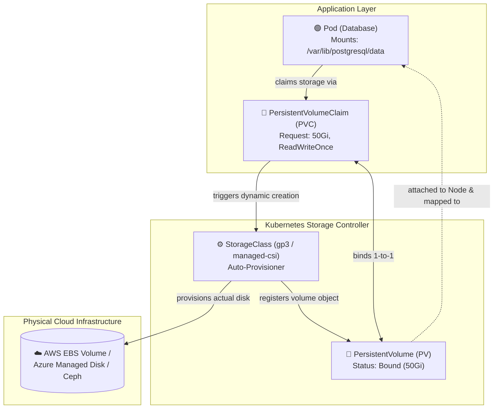

# 💾 Kubernetes Storage Deep Dive: PV, PVC & StorageClass

By default, Docker container filesystems are **ephemeral**. When a Pod crashes or gets rescheduled to another node, all files created inside are completely lost. To run stateful applications like PostgreSQL, MongoDB, or Redis, Kubernetes provides a persistent storage subsystem.

---

## 💡 Real-World Analogy
Think of Kubernetes storage like **renting a storage locker**:
- **StorageClass:** The **Locker Company** (e.g. AWS EBS, Azure Disk, NFS) that automatically constructs lockers on demand.
- **PersistentVolume (PV):** The **Physical Locker** built with a specific size (e.g., a 50GB storage unit).
- **PersistentVolumeClaim (PVC):** The **Rental Agreement / Voucher** submitted by the customer (*"I need a 20GB unit with single-renter access"*).
- **Pod:** The **Customer** storing and retrieving items in the unit.

---

## 📊 Visual Representation: Dynamic Storage Provisioning



---

## 🔑 Key Storage Concepts

### 1. Access Modes
A volume can be mounted with different access permissions:

| Access Mode | CLI Shorthand | What It Means | Typical Provider |
| :--- | :--- | :--- | :--- |
| **ReadWriteOnce** | `RWO` | Can be mounted as read-write by **only one single Node** at a time. | Block Storage (AWS EBS, Azure Disk, GCE PD). |
| **ReadOnlyMany** | `ROX` | Can be mounted as read-only by **many Nodes** simultaneously. | Shared Filesystems (NFS, AWS EFS). |
| **ReadWriteMany** | `RWX` | Can be mounted as read-write by **many Nodes** concurrently. | Network File Systems (NFS, AWS EFS, Azure Files, CephFS). |

### 2. Reclaim Policies
What happens to the physical disk when you delete the `PVC`?
- **`Delete` (Default for dynamic SC):** Automatically deletes the underlying cloud disk to save costs.
- **`Retain`:** Keeps the physical cloud disk intact for manual data recovery by an administrator.

---

## 📝 YAML Manifests

### 1. PersistentVolumeClaim (PVC)
```yaml
apiVersion: v1
kind: PersistentVolumeClaim
metadata:
  name: postgres-data-pvc
  labels:
    app: postgres
spec:
  accessModes:
    - ReadWriteOnce
  storageClassName: standard   # Or gp3 (AWS), managed-csi (Azure)
  resources:
    requests:
      storage: 20Gi
```

### 2. Mounting the PVC in a Pod / Deployment
```yaml
apiVersion: apps/v1
kind: Deployment
metadata:
  name: postgres-deploy
spec:
  replicas: 1
  selector:
    matchLabels:
      app: postgres
  template:
    metadata:
      labels:
        app: postgres
    spec:
      containers:
        - name: postgres
          image: postgres:16-alpine
          ports:
            - containerPort: 5432
          env:
            - name: POSTGRES_PASSWORD
              value: "postgres123"
            - name: PGDATA
              value: "/var/lib/postgresql/data/pgdata"
          volumeMounts:
            # Mounts the persistent disk at Postgres data directory
            - name: postgres-storage
              mountPath: /var/lib/postgresql/data
      volumes:
        - name: postgres-storage
          persistentVolumeClaim:
            claimName: postgres-data-pvc
```

---

## 🔍 Essential Storage Commands

```bash
# 1. View all StorageClasses available in your cluster
kubectl get sc

# 2. View PVCs and binding status
kubectl get pvc
# Output: NAME                STATUS   VOLUME                                     CAPACITY   ACCESS MODES
#         postgres-data-pvc   Bound    pvc-89b27568-71e8-4221-a128-4fa7be201a05   20Gi       RWO

# 3. View physical PVs
kubectl get pv

# 4. Describe PVC to troubleshoot why it is stuck in Pending
kubectl describe pvc postgres-data-pvc
```

---

## ⚠️ Troubleshooting Storage Issues

| Symptom | Cause | Resolution |
| :--- | :--- | :--- |
| **PVC stuck in `Pending`** | No PV matches the request, or the requested `storageClassName` does not exist. | Run `kubectl get sc` to verify valid StorageClasses. Check `kubectl describe pvc <name>` for provisioner errors. |
| **`Multi-Attach error for volume`** | An `RWO` disk is still attached to Node A, but the Pod was rescheduled to Node B. | Force terminate the stuck old pod, or verify the cloud provider CSI driver detached the EBS/Azure disk. |
| **Volume Mount Permission Denied** | The container process runs as a non-root user (e.g. UID 1000) but the mounted volume is owned by root. | Add `securityContext.fsGroup: 1000` to the Pod spec so Kubernetes grants group read/write access. |
