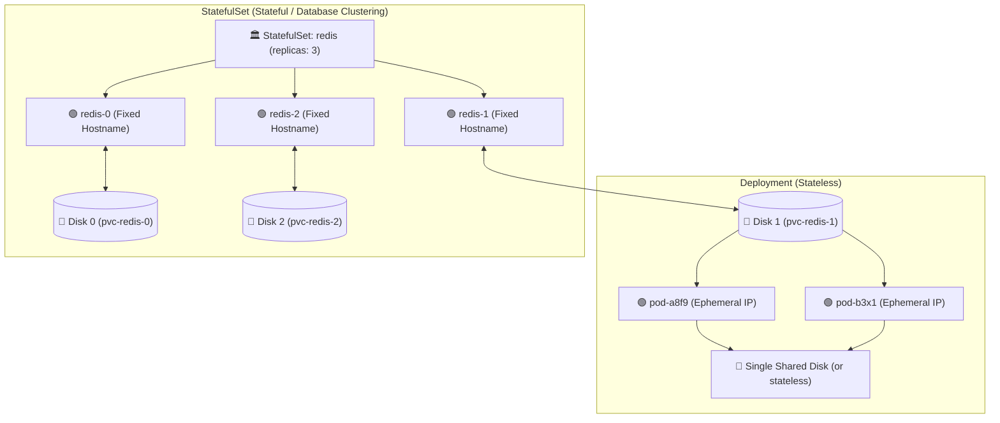

# 🏛️ Kubernetes StatefulSet Deep Dive

A **StatefulSet** is the workload API object used to manage stateful applications. Unlike Deployments where Pods are interchangeable and random, StatefulSet manages Pods with **persistent network identities** and **dedicated persistent storage per Pod**.

---

## 💡 Real-World Analogy
- **Deployment Pods:** Like **cattle / sheep**. If one sheep gets sick, you replace it with another identical sheep. They have random names (`app-74b88f-9x2pl`), share storage, and don't care about order.
- **StatefulSet Pods:** Like **pets**. Each pet has its own permanent name (`mysql-0`, `mysql-1`, `mysql-2`), its own personal food bowl (dedicated disk), and a specific rank (master node vs replica node).

---

## 📊 Visual Representation: StatefulSet vs Deployment



---

## ⚖️ Key Differences: Deployment vs. StatefulSet

| Feature | Deployment | StatefulSet |
| :--- | :--- | :--- |
| **Pod Naming** | Random hash: `app-64f89d8-9zx2b` | Stable, ordered ordinal: `app-0`, `app-1`, `app-2` |
| **Storage** | Shares volumes or stateless | Unique PVC per Pod via `volumeClaimTemplates` |
| **Startup Order** | All pods launch in parallel | Starts in strict order (`0` ➔ `1` ➔ `2`) |
| **Shutdown Order** | Terminates all pods concurrently | Gracefully shuts down in reverse (`2` ➔ `1` ➔ `0`) |
| **Network Identity** | Ephemeral, dynamic | Permanent DNS name via **Headless Service** |

---

## 🌐 Stable Network Identity via Headless Service

A StatefulSet requires a **Headless Service** (`clusterIP: None`). Each Pod gets its own permanent DNS record:

```text
<pod-name>.<service-name>.<namespace>.svc.cluster.local
```

For example, in a 3-node MongoDB replica set:
- `mongo-0.mongo-headless.default.svc.cluster.local` (Primary)
- `mongo-1.mongo-headless.default.svc.cluster.local` (Secondary Replica)
- `mongo-2.mongo-headless.default.svc.cluster.local` (Secondary Replica)

Even if `mongo-1` crashes and gets rescheduled to a different physical node with a different IP, **its hostname remains `mongo-1` and it automatically re-attaches to `Disk 1`!**

---

## 📝 YAML Manifest: Production StatefulSet

```yaml
# 1. Headless Service required for stable network routing
apiVersion: v1
kind: Service
metadata:
  name: redis-headless
  labels:
    app: redis
spec:
  clusterIP: None       # Headless (No cluster VIP)
  selector:
    app: redis
  ports:
    - port: 6379
      name: redis
---
# 2. StatefulSet Definition
apiVersion: apps/v1
kind: StatefulSet
metadata:
  name: redis
spec:
  serviceName: "redis-headless"
  replicas: 3
  selector:
    matchLabels:
      app: redis
  template:
    metadata:
      labels:
        app: redis
    spec:
      containers:
        - name: redis
          image: redis:7.0-alpine
          ports:
            - containerPort: 6379
              name: redis
          volumeMounts:
            - name: redis-data
              mountPath: /data
  # 3. Dedicated Disk for EVERY pod copy automatically
  volumeClaimTemplates:
    - metadata:
        name: redis-data
      spec:
        accessModes: [ "ReadWriteOnce" ]
        storageClassName: "standard"
        resources:
          requests:
            storage: 10Gi
```

---

## 🔍 Essential StatefulSet Commands

```bash
# 1. View StatefulSets and status
kubectl get statefulsets
kubectl get sts

# 2. View pods (Notice the clean sequential 0, 1, 2 naming)
kubectl get pods -l app=redis

# 3. View the dedicated PVCs created for each pod
kubectl get pvc -l app=redis
# Output:
# NAME                 STATUS   VOLUME
# redis-data-redis-0   Bound    pvc-10a...
# redis-data-redis-1   Bound    pvc-20b...
# redis-data-redis-2   Bound    pvc-30c...

# 4. Scale StatefulSet (Scales strictly 1 by 1)
kubectl scale statefulset redis --replicas=5
```

---

## ⚠️ Important Note on Deletion
When you delete a StatefulSet or scale down its replicas, **Kubernetes deliberately DOES NOT delete the associated PVCs or disks**. This prevents catastrophic accidental data loss. You must delete unused PVCs manually if no longer needed.
