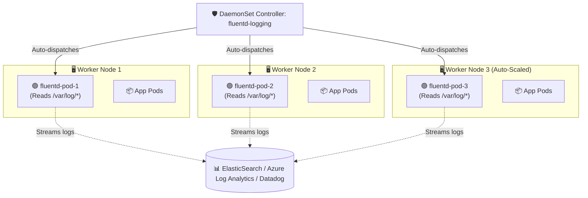

# 🛡️ Kubernetes DaemonSet Deep Dive

A **DaemonSet** guarantees that an exact copy of a Pod runs on **all (or selected) Nodes** in the cluster. As new nodes join the cluster, Pods are automatically added to them; as nodes leave, those Pods are cleanly garbage collected.

---

## 💡 Real-World Analogy
Think of a DaemonSet like a **building security guard**:
- If you own 1 building (Node), you station 1 security guard (Pod).
- If your company buys 5 new buildings tomorrow, you automatically station 1 security guard in each new building without having to manually request them.
- If a building is sold, the guard is reassigned.

---

## 📊 Visual Representation: DaemonSet Across Cluster Nodes



---

## 🎯 Typical Use Cases for DaemonSets

1. **Cluster Log Collection:** Running a log collector on every node to parse `/var/log` (e.g., Fluentd, Filebeat, Vector).
2. **Node Monitoring & Metrics:** Running system resource monitors (e.g., Prometheus `node-exporter`, Datadog Agent).
3. **Cluster Networking (CNI):** Running network fabric agents on every node (e.g., `calico-node`, `cilium`, `kube-proxy`, `aws-node`).
4. **Storage Daemons:** Running distributed storage agents (e.g., Ceph OSD, GlusterFS).

---

## 📝 YAML Manifest: Production DaemonSet (Log Shipper)

```yaml
apiVersion: apps/v1
kind: DaemonSet
metadata:
  name: node-log-collector
  namespace: kube-system
  labels:
    app: log-collector
spec:
  selector:
    matchLabels:
      app: log-collector
  template:
    metadata:
      labels:
        app: log-collector
    spec:
      # Tolerations allow running on Control-Plane / Master nodes if needed
      tolerations:
        - key: node-role.kubernetes.io/control-plane
          operator: Exists
          effect: NoSchedule
      containers:
        - name: log-collector
          image: fluent/fluent-bit:2.2-debug
          resources:
            limits:
              memory: 200Mi
              cpu: 100m
            requests:
              cpu: 50m
              memory: 64Mi
          volumeMounts:
            # Mount the physical node's /var/log directory into the container
            - name: varlog
              mountPath: /var/log
              readOnly: true
      terminationGracePeriodSeconds: 30
      volumes:
        - name: varlog
          hostPath:
            path: /var/log
```

---

## ⚙️ Targeting Specific Nodes (`nodeSelector` & `tolerations`)

By default, DaemonSets run on **every node**. You can restrict them to run only on specific hardware:

### Running only on GPU nodes:
```yaml
nodeSelector:
  hardware: gpu-enabled
```

### Running on Master / Control-Plane Nodes:
Control-plane nodes usually have a **Taint** (`NoSchedule`) to prevent normal workloads. A DaemonSet must declare a **Toleration** to run on them:
```yaml
tolerations:
  - key: node-role.kubernetes.io/control-plane
    operator: Exists
    effect: NoSchedule
```

---

## 🔍 Essential DaemonSet Commands

```bash
# 1. View DaemonSets across all namespaces
kubectl get ds -A

# 2. Check rollout progress (DESIRED vs CURRENT vs READY)
kubectl get daemonsets node-log-collector -n kube-system

# 3. View pod placement on nodes
kubectl get pods -n kube-system -l app=log-collector -o wide

# 4. Perform zero-downtime rolling update of a DaemonSet
kubectl rollout restart ds/node-log-collector -n kube-system
```
