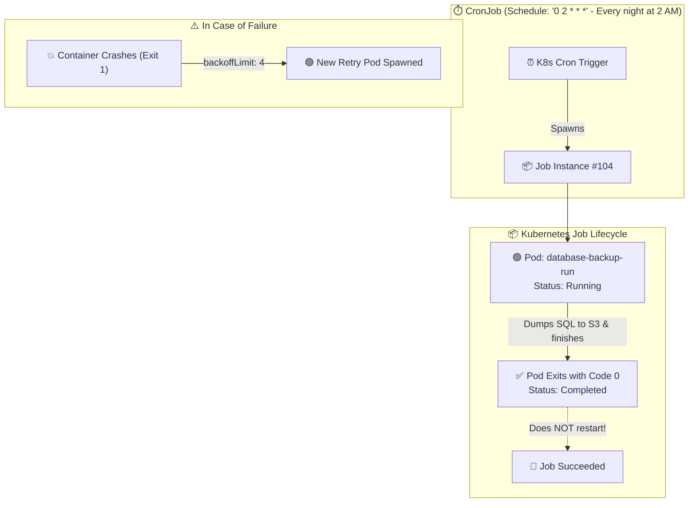

# ⏱️ Kubernetes Jobs & CronJobs Deep Dive

While Deployments and StatefulSets are designed to run applications **continuously forever** (web servers, APIs, databases), **Jobs** and **CronJobs** are designed for workloads that run to **completion** and then stop.

---

## 💡 Real-World Analogy
- **Deployment:** A **24/7 security guard** or utility company. If they fall asleep or leave, a supervisor replaces them immediately.
- **Job:** A **plumber or delivery driver**. They arrive, complete the specific task, report `SUCCESS`, and leave.
- **CronJob:** A **scheduled cleaning crew**. Every night at 2:00 AM, they arrive, clean the building, and exit.

---

## 📊 Visual Representation: Job vs CronJob Flow



---

## 🔑 Job vs. CronJob Core Differences

| Feature | Job | CronJob |
| :--- | :--- | :--- |
| **Trigger** | Manual (`kubectl apply`) or triggered by CI/CD. | Time-based automatic recurring schedule (cron). |
| **Object Type** | Single execution batch workload. | Supervisor that generates Jobs on schedule. |
| **Lifecycle** | Runs until `completions` succeed. | Creates a new Job each time schedule triggers. |
| **Common Use** | Database migrations, one-off imports, ML training. | Daily backups, monthly invoice billing, report generation. |

---

## 📝 YAML Manifests

### 1. One-Off Job (Database Schema Migration)
```yaml
apiVersion: batch/v1
kind: Job
metadata:
  name: db-schema-migration
spec:
  backoffLimit: 3             # Retry up to 3 times if it fails before giving up
  ttlSecondsAfterFinished: 300 # Auto-delete the finished Job & Pods after 5 minutes
  template:
    spec:
      restartPolicy: OnFailure # Required for Jobs: OnFailure or Never (NOT Always!)
      containers:
        - name: migrator
          image: myregistry.azurecr.io/migration-tool:v1.0
          command: ["npm", "run", "db:migrate"]
          env:
            - name: DATABASE_URL
              valueFrom:
                secretKeyRef:
                  name: db-secrets
                  key: DB_URL
```

### 2. Scheduled CronJob (Nightly Database Backup)
```yaml
apiVersion: batch/v1
kind: CronJob
metadata:
  name: nightly-s3-backup
spec:
  schedule: "0 2 * * *"       # Cron syntax: Every night at 2:00 AM UTC
  concurrencyPolicy: Forbid    # Do NOT start a new backup if the previous one is still running!
  successfulJobsHistoryLimit: 3
  failedJobsHistoryLimit: 1
  jobTemplate:
    spec:
      backoffLimit: 2
      template:
        spec:
          restartPolicy: OnFailure
          containers:
            - name: s3-backup
              image: amazon/aws-cli:latest
              command:
                - /bin/sh
                - -c
                - pg_dumpall -h postgres-db | aws s3 cp - s3://my-backups/$(date +%Y-%m-%d).sql
```

---

## 📅 Understanding Cron Syntax & Concurrency

Standard 5-field cron syntax:
```text
┌───────────── Minute (0 - 59)
│ ┌─────────── Hour (0 - 23)
│ │ ┌───────── Day of month (1 - 31)
│ │ │ ┌─────── Month (1 - 12)
│ │ │ │ ┌───── Day of week (0 - 6) (0 is Sunday)
│ │ │ │ │
* * * * *
```

- `*/15 * * * *` = Every 15 minutes.
- `0 0 * * 0` = Every Sunday midnight.

### Concurrency Policies:
- **`Allow` (Default):** Runs concurrent jobs simultaneously.
- **`Forbid`:** If the old job is still running, skips the new run. (Recommended for backups).
- **`Replace`:** If the old job is still running, kills it and starts the new one.

---

## 🔍 Essential Job & CronJob Commands

```bash
# 1. View Jobs and completion status
kubectl get jobs
# Output: NAME                  COMPLETIONS   DURATION   AGE
#         db-schema-migration   1/1           42s        2m

# 2. View CronJobs and schedules
kubectl get cronjobs
kubectl get cj

# 3. Manually trigger a CronJob immediately (without waiting for the schedule!)
kubectl create job --from=cronjob/nightly-s3-backup manual-test-run-1

# 4. View logs of a completed Job
kubectl logs job/db-schema-migration

# 5. Delete a job and all its finished pods
kubectl delete job db-schema-migration
```
