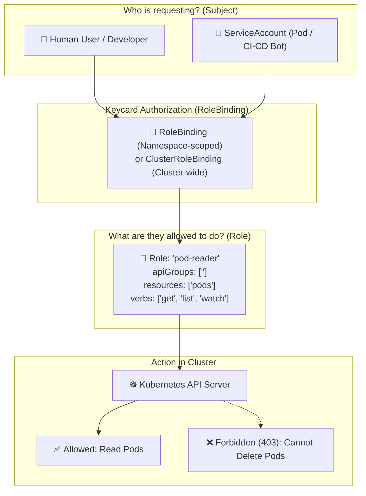

# 🏷️ Kubernetes Namespaces, RBAC & ResourceQuotas Deep Dive

As clusters grow, multiple teams and environments share the same physical infrastructure. Kubernetes provides **Namespaces** for logical partitioning, **ResourceQuotas** for cost/resource guardrails, and **RBAC (Role-Based Access Control)** for security.

---

## 💡 Real-World Analogy
Think of a Kubernetes Cluster like an **office complex building**:
- **Namespace:** Individual **rented floors** in the building (Floor 1: `marketing`, Floor 2: `engineering`). Each team operates inside their own floor without bumping into others.
- **ResourceQuota:** The **utility limit** (*"Floor 2 cannot consume more than 50 kW power"*).
- **RBAC:** The **keycard access system** (*"Engineering interns can enter the room and look at monitors, but only Lead DevOps Engineers can flip the master power switch"*).

---

## 📊 Visual Representation: RBAC Architecture



---

## 🏷️ Namespaces: Scope & Rules

### What is Scoped to a Namespace?
- **Namespace-Scoped:** Pods, Deployments, Services, ConfigMaps, Secrets, PVCs, Roles, ServiceAccounts.
- **Cluster-Scoped (Global):** Nodes, PersistentVolumes (PVs), Namespaces, StorageClasses, ClusterRoles.

---

## 🛡️ ResourceQuotas & LimitRanges

Prevent a single rogue pod from consuming 100% of your cluster's CPU and crashing the node:

### 1. ResourceQuota (Total limits for the whole Namespace)
```yaml
apiVersion: v1
kind: ResourceQuota
metadata:
  name: team-quota
  namespace: development
spec:
  hard:
    requests.cpu: "4"           # Whole namespace cannot request > 4 cores
    requests.memory: 8Gi        # Whole namespace cannot request > 8GB RAM
    limits.cpu: "8"
    limits.memory: 16Gi
    pods: "20"                  # Maximum 20 pods allowed in this namespace
```

### 2. LimitRange (Default per-pod limits)
Ensures any developer who forgets to define `resources` in their Pod automatically gets a default limit:
```yaml
apiVersion: v1
kind: LimitRange
metadata:
  name: default-pod-limits
  namespace: development
spec:
  limits:
    - default:                  # Default limit if unspecified
        cpu: 500m
        memory: 512Mi
      defaultRequest:           # Default request if unspecified
        cpu: 100m
        memory: 128Mi
      type: Container
```

---

## 🔑 RBAC in Action: ServiceAccount, Role, and RoleBinding

### Step 1: Create a ServiceAccount (Identity for an app)
```yaml
apiVersion: v1
kind: ServiceAccount
metadata:
  name: cicd-deployer-sa
  namespace: development
```

### Step 2: Create a Role (Permissions rulebook)
```yaml
apiVersion: rbac.authorization.k8s.io/v1
kind: Role
metadata:
  name: deployment-manager-role
  namespace: development
rules:
  - apiGroups: ["apps"]
    resources: ["deployments"]
    verbs: ["get", "list", "watch", "create", "update", "patch"]
  - apiGroups: [""]
    resources: ["pods", "pods/log"]
    verbs: ["get", "list"]
```

### Step 3: Create a RoleBinding (Attach identity to permissions)
```yaml
apiVersion: rbac.authorization.k8s.io/v1
kind: RoleBinding
metadata:
  name: bind-cicd-to-deployer
  namespace: development
subjects:
  - kind: ServiceAccount
    name: cicd-deployer-sa
    namespace: development
roleRef:
  kind: Role
  name: deployment-manager-role
  apiGroup: rbac.authorization.k8s.io
```

---

## 🔍 Essential Commands

```bash
# 1. List all namespaces
kubectl get namespaces
kubectl get ns

# 2. View resources in a specific namespace
kubectl get pods -n development

# 3. View quotas and current usage
kubectl get resourcequotas -n development
kubectl describe quota team-quota -n development

# 4. Check YOUR permissions using 'auth can-i' (Very useful!)
kubectl auth can-i create deployments --namespace development
# Output: yes

kubectl auth can-i delete pods --as=system:serviceaccount:development:cicd-deployer-sa -n development
# Output: no
```
